# diffusion-workbench

**Diffusion and flow models for images in plain PyTorch, built to see how each formulation works:
DDPM (ε, x0 and v prediction, linear and cosine schedules) with ancestral and DDIM sampling, score-based
SDEs (VP and VE, reverse SDE and probability-flow ODE), flow matching / rectified flow, EDM, and
classifier-free guidance, all sharing one small U-Net (or a DiT), one training loop, one sampler
interface and one evaluation, compared on MNIST with a classifier-feature FID and quality-vs-NFE curves.**

[](LICENSE)
[](pyproject.toml)
[](https://pytorch.org)
[](docs/testing.md)

Every method here is the same idea, add Gaussian noise and learn to remove it, with three choices
changed: **how the noise is added**, **what the network predicts**, and **how the reverse process is
integrated**. The code puts each method in one class with two functions, `loss()` and `sample()`, so
those three choices are all there is to read. The models are small on purpose (0.2 M parameters by
default): they train in minutes on a CPU, so you can watch each mechanism learn and compare them on
equal terms; a Kaggle/Colab notebook trains them bigger on CIFAR-10.

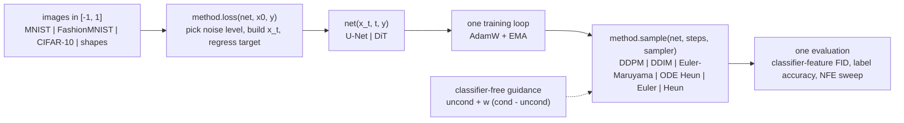

| method | flag | how it works, in one line | samplers (`--sampler`) | code |
|---|---|---|---|---|
| DDPM | `--method ddpm` | `x_t = sqrt(ā) x0 + sqrt(1-ā) ε`, regress the noise ε (the simplified ELBO) | `ddpm` (ancestral), `ddim` | `methods.DDPM` |
| x0 / v prediction | `--prediction x0` / `v` | same process, the network predicts the clean image, or `v = sqrt(ā) ε - sqrt(1-ā) x0` | same | `DDPM.to_x0_eps` |
| cosine schedule | `--schedule cosine` | `ā_t` follows a squared cosine: noise levels spread evenly instead of destroying the image early | same | `DDPM.__init__` |
| DDIM | `--sampler ddim` | the same trained DDPM, deterministic jumps over a subset of steps (η = 0) | — | `DDPM.sample` |
| score SDE, VP | `--method score-sde --sde vp` | continuous-time DDPM; learn the score `-ε/s(t)`, run the reverse SDE or the probability-flow ODE | `em`, `ode` | `methods.ScoreSDE` |
| score SDE, VE | `--method score-sde --sde ve` | `x_t = x0 + s(t) ε`, `s` grows from 0.01 to 50 (NCSN) | `em`, `ode` | `methods.ScoreSDE` |
| flow matching | `--method flow-matching` | straight line `x_t = (1-t) x0 + t ε`, regress the velocity `ε - x0`, integrate an ODE | `euler`, `heun` | `methods.FlowMatching` |
| EDM | `--method edm` | `x0 + σ ε` with Karras' preconditioning (unit-variance input and target at every σ), Heun on a ρ = 7 schedule | `heun`, `euler` | `methods.EDM` |
| classifier-free guidance | `--cond` then `--guidance w` | train with labels dropped 10% of the time, sample `uncond + w (cond - uncond)`; works with every method | any | `methods.guided` |
| U-Net / DiT backbone | `--backbone unet` / `dit` | convolutional U-Net with attention at 7 x 7, or a patch Transformer with adaLN-Zero | — | `backbones.UNet`, `backbones.DiT` |

The equations, shapes and the reasons behind each choice are in [docs/architecture.md](docs/architecture.md).

## Before and after training

**The problem:** a network that has not learned anything cannot turn noise into images. Every
backbone here starts with a zero output layer, so the untrained model predicts 0. What that does
depends on the method: x0-prediction returns a flat grey image (the "clean image" it predicts is all
zeros), and flow matching leaves the noise untouched (zero velocity). **The fix is the training
objective:** after 500 steps (about half an MNIST epoch on a CPU, 0.21 M parameters), the *same starting
noise* goes through the *same sampler* and comes out as digits. With classifier-free guidance (bottom
row), the requested labels 0, 1, 2, 3, ... are followed.

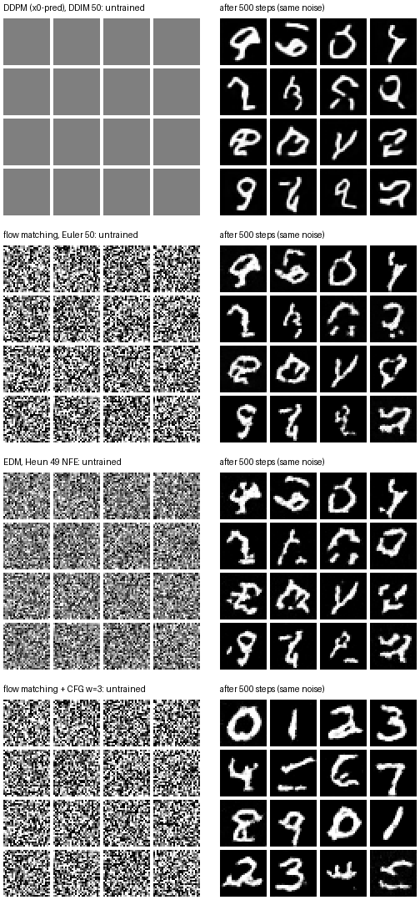

**The reverse process, step by step.** Below, the same 16 noise images are pushed through four
samplers, each frame at the same fraction of its steps. DDIM, flow matching and EDM are deterministic,
and they end on nearly the same digits: they learned almost the same noise-to-image map. EDM's Heun
steps on the Karras schedule resolve the shapes earliest. DDPM's ancestral sampler injects fresh noise
at every step, so the same start ends on different digits, and it stays grainy until the last steps.

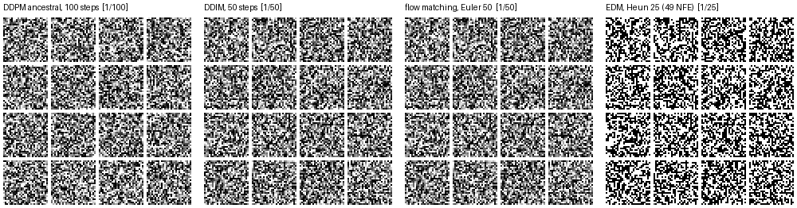

**Learning, checkpoint by checkpoint.** Below is one fixed set of 36 noise images, sampled with Euler at
20 steps from flow-matching snapshots saved every 25 training steps. Noisy strokes appear at step 75,
clean strokes by step 150, and from step 300 on each noise image keeps its digit shape, which only gets
smoother.

<p align="center">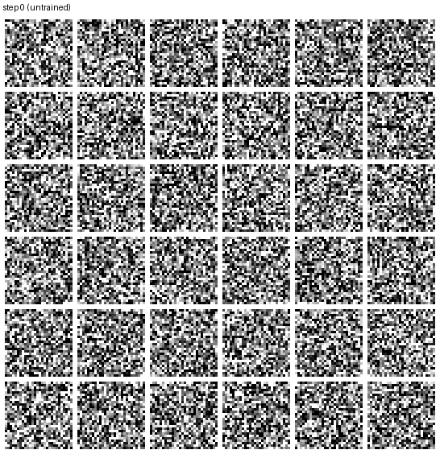</p>

`python scripts/make_gifs.py` regenerates all three from the saved checkpoints
(`scripts/compare_all.py` runs, plus a `--save-every 25` flow-matching run).

> **No pretrained weights are published.** Everything trains in minutes on the built-in data;
> bigger runs are for the Kaggle/Colab notebook.

## Quick start

```bash
git clone https://github.com/benisalla/diffusion-workbench && cd diffusion-workbench
uv venv .venv && VIRTUAL_ENV=.venv uv pip install -e ".[dev]"     # or: pip install -e ".[dev]"
source .venv/bin/activate

diffusion-data mnist                                              # 11 MB download (or `shapes`: offline)
diffusion-train --method flow-matching --max-steps 500 --output-dir runs/flow
diffusion-sample runs/flow/last.pt --sampler heun --steps 10 --out flow.png --trajectory traj.png
diffusion-eval runs/flow/last.pt --nfe 5 10 20 50 --n-samples 500
```

Swap `--method` for `ddpm` (with `--prediction eps|x0|v`, `--schedule linear|cosine`), `score-sde`
(`--sde vp|ve`) or `edm`; add `--backbone dit` or `--cond` (then `diffusion-sample ... --labels all
--guidance 3`). `diffusion-train --help` lists every flag; [docs/training.md](docs/training.md) explains them.

## Examples

[`examples/`](examples/README.md) holds five scripts that use the package from Python, in reading
order, each one command on a CPU with the offline shapes data: the forward process of every method
side by side (seconds), training one method chosen by flag and drawing its denoising trajectory, the
same checkpoint with every sampler at 5-50 NFE, classifier-free guidance at w = 0 / 1 / 3, and all
methods on one budget in one table.

```bash
python examples/01_forward_process.py
python examples/02_train_one_method.py --method edm      # or ddpm / flow-matching / score-sde
```

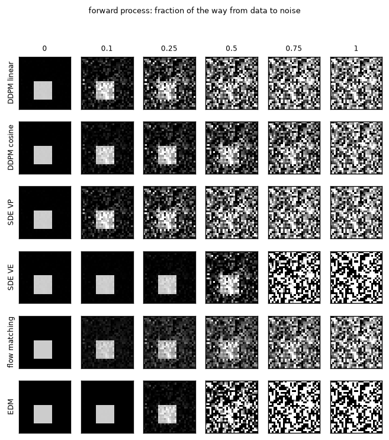

## Results on MNIST (short CPU runs)

These are **short CPU runs, not benchmarks**: their purpose is to show that every formulation learns
and to compare them on equal terms. Each model: the default U-Net (16 channels, 0.21 M parameters) or
the DiT (1.25 M), **500 steps of batch 64 (about half an epoch)**, AdamW lr 1e-3 (DiT 5e-4), EMA weights,
one CPU thread on a shared, busy machine (`python scripts/compare_all.py`, then `scripts/results_table.py`).
Each FID point uses 200 generated images against the 10 000 test images; lower is better, and **200 real
images score 0.13** (the floor). The FID is computed on the features of a small MNIST classifier
(97% test accuracy), **not Inception**: it ranks the runs of this table, nothing else
([docs/evaluation.md](docs/evaluation.md)).

| run (main sampler) | backbone | params | train | NFE 5 | NFE 10 | NFE 20 | NFE 50 | NFE 100 | 2nd sampler, NFE 10 / 50 | sampling, s / 100 img at NFE 20 |
|---|---|---|---|---|---|---|---|---|---|---|
| `ddpm-eps` (`ddim`) | U-Net | 0.21 M | 4.0 min | 516.5 | 420.7 | 369.9 | 347.4 | 343.3 | `ddpm` 278.2 / 107.6 | 4.3 s |
| `ddpm-x0` (`ddim`) | U-Net | 0.21 M | 3.6 min | 2.09 | 1.41 | 1.19 | **1.06** | **1.06** | `ddpm` 1.42 / **1.04** | 5.9 s |
| `ddpm-v` (`ddim`) | U-Net | 0.21 M | 3.3 min | 5.91 | 3.12 | 2.43 | 2.20 | 2.17 | `ddpm` 2.51 / 1.71 | 6.5 s |
| `score-sde-vp` (`ode`) | U-Net | 0.21 M | 4.0 min | 372.3 | 477.7* | 539.3* | 561.1* | 574.3* | `em` 1400.7 / 75.4 | 3.9 s |
| `score-sde-ve` (`ode`) | U-Net | 0.21 M | 3.3 min | 1762.0 | 1553.2* | 490.0* | 436.1* | 492.1* | `em` 1913.1 / 266.5 | 3.8 s |
| `flow-matching` (`euler`) | U-Net | 0.21 M | 8.8 min† | 4.24 | 2.43 | 1.92 | 1.68 | 1.62 | `heun` 1.67* / 1.56* | 10.7 s† |
| `edm` (`heun`) | U-Net | 0.21 M | 4.0 min | 492.3 | 30.8* | 2.60* | 2.43* | 2.40* | `euler` 2.86 / 2.44 | 4.3 s |
| `flow-matching-cfg` (`euler`, w = 1) | U-Net | 0.21 M | 3.4 min | 3.33 | 2.31 | 2.07 | 1.81 | 1.82 | — | 4.6 s |
| `flow-matching-dit` (`euler`) | DiT | 1.25 M | 3.9 min | 13.75 | 15.35 | 16.54 | 17.26 | 17.62 | `heun` 16.68* / 17.50* | 4.9 s |

\* Heun samplers cost `2N - 1` evaluations, so these points are at NFE 9, 19, 49, 99.
† the first run, while the machine was busiest; the others ran when it was quieter.
The whole table took 62 minutes of CPU time (training + evaluation).

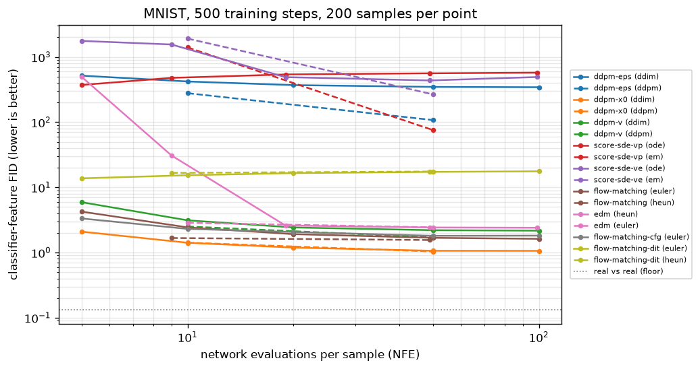

What the runs show:

- **x0-, v-prediction, flow matching and EDM all produce digits after half an epoch**, and with the
  same starting noise they produce *the same digits* (compare the panels below): deterministic samplers
  of different formulations learn nearly the same noise-to-image map. `x0`-prediction is the best here
  (FID 1.06): with so little training, predicting the image directly is the easiest target for a small
  U-Net on MNIST's mostly-black images.
- **ε-prediction is the slowest to learn, and deterministic samplers expose it.** `ddpm-eps` with DDIM
  and both score SDEs with the probability-flow ODE leave many samples covered in noise (the VP
  trajectory figure shows why: near pure noise an ε-network that outputs roughly `x_t` makes the ODE
  drift almost zero, so a small error in `ε̂` leaves noise that nothing removes later; their ODE FID
  even gets worse with more steps). The **stochastic samplers fix part of it**: DDPM ancestral (108 vs
  343 for DDIM at 50 NFE) and Euler-Maruyama (75 vs 561) re-inject noise that washes out earlier errors.
  The exact-denoiser tests show the samplers themselves are right; this is a training-budget effect,
  and it is exactly the instability that motivated v-prediction and EDM's preconditioning.
- **Few-step sampling**: flow matching with Euler is already usable at 5 NFE (4.2), Heun at 9 NFE (1.67)
  matches Euler at 50. EDM's Heun needs ~19 NFE: with 3 steps on a ρ = 7 schedule its first step spans
  σ = 80 → 2.5. DDIM on the x0 / v models is good from 10 NFE; DDPM's ancestral sampler needs more steps
  but ends slightly better (1.04 vs 1.06, 1.71 vs 2.20).
- **The DiT is not there yet after 500 steps** (blocky 4 x 4 patches): with no convolutional prior a
  Transformer needs many more steps on small data. It is in the notebook's longer GPU runs.

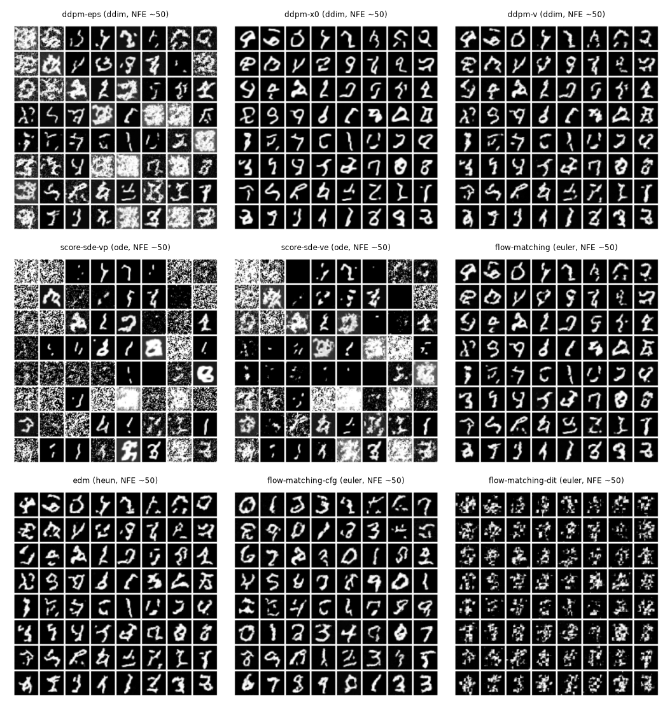

### Classifier-free guidance (`flow-matching-cfg`, Euler, 20 NFE)

The same class-conditional model (labels dropped 10% of the time during training), 200 samples, one
per label in turn; label accuracy = how often the MNIST classifier recognises the requested digit.

| guidance w | FID | label accuracy |
|---|---|---|
| 0 (label ignored) | 3.20 | 11.0% (chance) |
| 1 (plain conditional) | 2.07 | 58.5% |
| 3 | **1.10** | **96.0%** |

At this budget the conditional model alone (w = 1) only follows the label 58% of the time; guidance
w = 3 pushes it to 96% and *also* improves FID, because the extrapolation sharpens the blurry samples of
an undertrained model. (With a well-trained model, large w usually trades diversity for fidelity, which
the notebook's sweep up to w = 5 shows.)

| w = 1 | w = 3 |
|---|---|
| 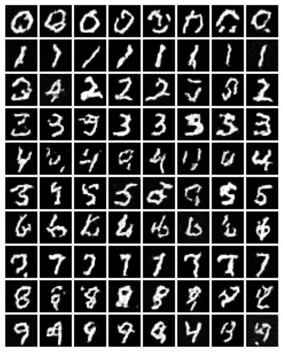 | 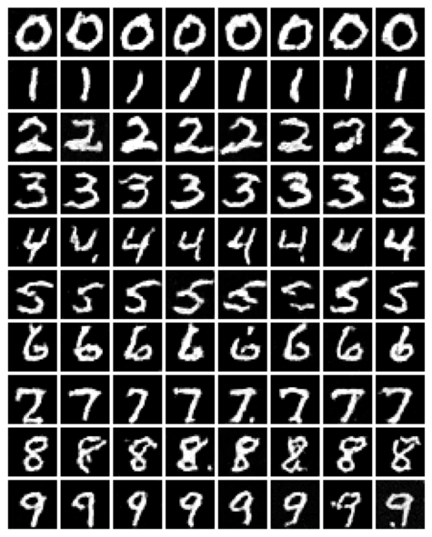 |

### Denoising trajectories (NFE 20)

Rows alternate `x_t` and the network's current guess of the final image `x̂0`; columns go from noise to
data. The guess has the digit's shape long before `x_t` is clean.

| flow matching (Euler) | EDM (Heun) |
|---|---|
| 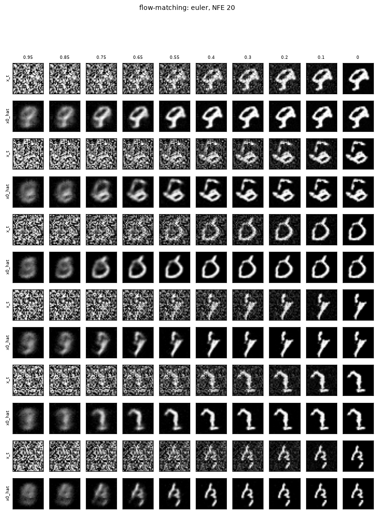 | 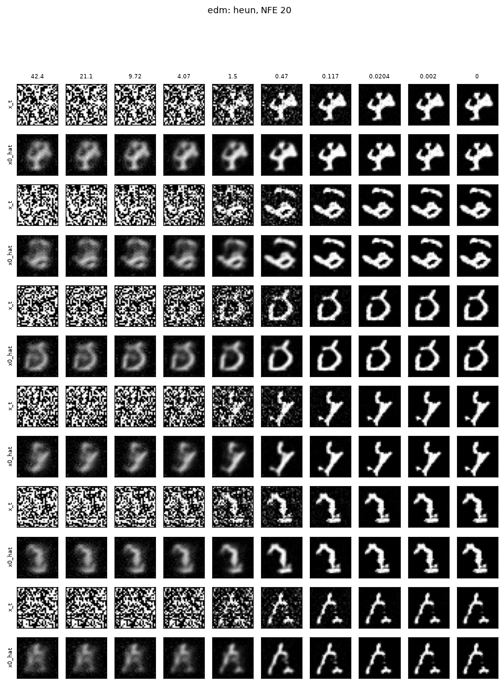 |

Loss curves (relative to each method's first logged value, since every method regresses a different
target): [assets/loss_curves.png](assets/loss_curves.png). All numbers are in
[assets/results.json](assets/results.json); the commands are in [docs/evaluation.md](docs/evaluation.md).

## Train for real: Kaggle / Colab notebook

[`notebooks/train_colab_kaggle.ipynb`](notebooks/train_colab_kaggle.ipynb) (generated by
`notebooks/build_notebook.py`) installs this package from GitHub and walks through the forward
process, the reverse process and the ε objective (from the ELBO), DDIM, x0 / v prediction, score
matching and SDEs, flow matching, EDM and classifier-free guidance, each explanation followed by the
package's own code for it. It then trains every method with a 64-channel U-Net (and a DiT) on
CIFAR-10 on a free GPU, draws the FID-vs-NFE curves, the denoising trajectories, and a guidance sweep.
`SMOKE_TEST = True` runs every cell in minutes on a CPU.

## Repository layout

```
src/diffusion/
  config.py      ModelConfig, MethodConfig, TrainConfig (saved in every checkpoint)
  backbones.py   time / label conditioning, UNet, DiT
  methods.py     DDPM, ScoreSDE, FlowMatching, EDM, classifier-free guidance
  data.py        MNIST / FashionMNIST / CIFAR-10 / shapes as tensors, `diffusion-data`
  train.py       the training loop + EMA, `diffusion-train`
  sample.py      load_checkpoint, generate, NFE counter, `diffusion-sample`
  evaluate.py    feature classifier, classifier-feature FID, label accuracy, NFE sweep, `diffusion-eval`
  metrics.py     Fréchet distance
  viz.py         grids, trajectories, loss and NFE curves
docs/            architecture, training, data, evaluation, testing
examples/        five scripts, 01 ... 05
scripts/         compare_all.py (the README runs), results_table.py (tables + figures),
                 make_gifs.py (before/after figure, reverse-process and training GIFs)
tests/           45 tests
notebooks/       build_notebook.py -> train_colab_kaggle.ipynb
assets/          figures from the runs below
legacy/          the original coursework notebook
```

## Documentation

- [docs/architecture.md](docs/architecture.md): every formulation, its equations, the samplers, the backbones
- [docs/training.md](docs/training.md): the loop, EMA, flags, sizes and timings
- [docs/evaluation.md](docs/evaluation.md): classifier-feature FID, label accuracy, NFE sweeps
- [docs/data.md](docs/data.md): datasets and the offline shapes generator
- [docs/testing.md](docs/testing.md): what the tests check, including the exact-denoiser sampler tests
- [examples/](examples/README.md): the package from Python, step by step

## Legacy notebooks

[`legacy/`](legacy/README.md) keeps the original Centrale coursework notebook: text-to-image
*inference* with pretrained Stable Diffusion 3.5 (4-bit) and a small Stable Diffusion through
`diffusers`. It used `num_inference_steps` and `guidance_scale` as black-box knobs; this repository
builds what is behind them. The legacy README lists the notebook's problems and what replaced them.

## References

Ho, Jain & Abbeel 2020 (DDPM) · Nichol & Dhariwal 2021 (cosine schedule) · Song, Meng & Ermon 2021
(DDIM) · Salimans & Ho 2022 (v-prediction) · Song et al. 2021 (score SDEs) · Lipman et al. 2023 (flow
matching) · Liu, Gong & Liu 2023 (rectified flow) · Karras et al. 2022 (EDM) · Ho & Salimans 2022
(classifier-free guidance) · Peebles & Xie 2023 (DiT) · Heusel et al. 2017 (FID).

## License

MIT
